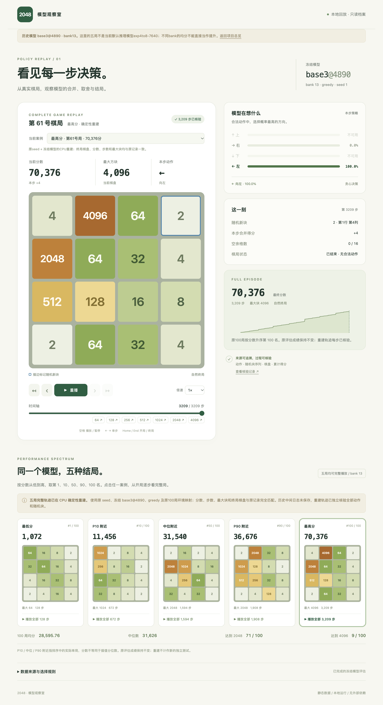
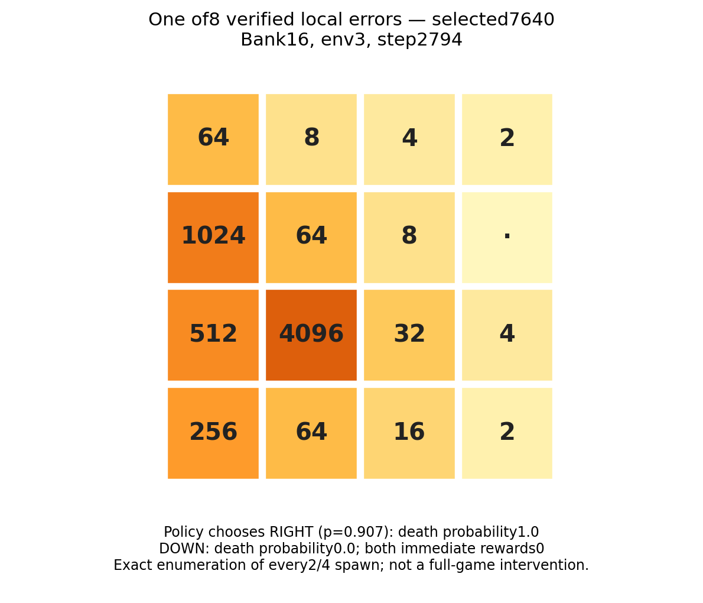

# 2048 PPO Lab 🧩

**一个不到100万参数、会合成4096，也会把自己堵死的2048机器人。**

这里保存了一段已经结束的实验：从普通合并分数，到逐渐偏爱大块的奖励；从看均分，到翻开每一步，发现“更想要大块”并不等于“更会活下去”。项目包括可运行的PPO核心、两个固定推理模型，以及五局从开局到终局都能拖动查看的历史回放。

> A small, inspectable PPO player for 2048: fixed CPU inference weights, complete game replays, and an honest reward-shaping experiment story. This is an educational experiment archive, not a state-of-the-art claim or an 8192-solving bot.

训练已结束。本次整理没有继续训练、调参或部署在线机器人。仓库保持私有，未发布GitHub Pages。

## 先玩起来

需要Python3.11或3.12。第一次安装需要网络下载NumPy/PyTorch；运行时不需要API、登录、模型下载服务或GPU。

```sh
git clone https://github.com/wjjpku/2048-ppo-lab.git
cd 2048-ppo-lab
python3 scripts/demo_cpu.py
```

这一条命令建立本项目的`.venv`、安装CPU依赖，加载**exp4to8-7640**并贪心玩一局。输出目录会打印到终端；其中`replay.html`是可直接打开的完整回放，`replay.json`保留每一步棋盘、概率、动作、新块和得分。重复运行生成不同目录，不覆盖历史输出。它复用bank16用于演示，不算新增独立实验。

已有环境也可以手动安装：

```sh
python3 -m venv .venv
source .venv/bin/activate
# Linux如需明确仅安装CPU版，先执行下一行；macOS跳过：
# python -m pip install torch==2.11.0 --index-url https://download.pytorch.org/whl/cpu
python -m pip install '.[test]'
python -m game2048 models
python -m game2048 demo --model exp4to8-7640 --output demo-output/exp-demo
python -m game2048 demo --model base4-5840 --output demo-output/base4-demo
```

默认CPU、单线程、greedy、自然终局；60秒软截止若先到，会明确标记未完成，不能把部分分数当完整成绩。`--mode sample`启用categorical采样，`--episodes`、`--seed`、`--bank`可显式指定。跨硬件/版本的FP32小差异可能在概率几乎相同时改变后续棋局。

## 打开五局完整观察室



```sh
python3 scripts/serve_replays.py
# 浏览器打开 http://127.0.0.1:2049/
```

这部分只依赖Python标准库和浏览器：没有npm构建、CDN、外部字体或在线服务。端口可用`--port`更改；Ctrl+C停止。

五局展示**旧模型base3@4890、bank13、greedy**，分别为原100局按`(score, env_id)`排序的第1、10、50、90、100名：128、672、1594、1908、3209步，共7511步。可暂停、单步、变速、拖时间轴、跳首尾及方块里程碑。页面另保留原env0的835步历史记录。

这五局是从已冻结旧模型和原seed确定性重建的轨迹；终局棋盘、分数、长度和最大块全部匹配原结果，所有步骤和RNG均已核验。原五局的历史中间日志未保存，不能称为与历史逐步日志逐项比对。**它们不是默认推理模型7640的成绩。**

## 两个打包模型

| CLI名称 | 检查点 | 奖励底数 | 内容 |
|---|---:|---:|---|
| `base4-5840` | 5840 | 4 | 共同父模型 |
| `exp4to8-7640`（默认） | 7640 | 7.464005 | 指数4→8续训第1800步，按固定验证选中 |

两个模型都是977,605参数：4×4×21 one-hot输入，共享两层832宽ReLU MLP，4动作policy head和标量value head。每个推理文件约3.9MB，只含权重及最小元数据，**没有optimizer、环境、RNG或机器信息**。加载时验证SHA256并使用`weights_only=True`。在原CPU运行时，各64个真实局面导出前后logits/value逐元素完全相等；仓库测试另检查可移植数值容差。

最终训练到7840、base8、LR0，但验证选择的是7640。打包的是选中模型，不应把它叫作“最终base8模型”。详见[模型卡](MODEL_CARD.md)及[权重清单](game2048/assets/models/manifest.json)。

```python
from game2048.inference import load_model, predict

model, info = load_model("exp4to8-7640")
# 棋盘保存的是指数：0为空，1=2，2=4，11=2048。
board = [[1, 1, 0, 0], [0, 0, 0, 0], [0, 0, 0, 0], [0, 0, 0, 0]]
print(predict(model, board))  # 动作顺序：上、右、下、左；非法动作概率0
```

## 奖励越来越偏爱大块，发生了什么？

每次合并输出`2^k`，训练奖励为`b^(k-10)`；1024合并始终为1。`b=2`相当于原始游戏分数除以1024。随后探索了base3、3.3、3.5、4，以及从4指数增加到8的2000次更新。游戏的raw score始终按原规则计算。

底数提高不是统一放大奖励：base4→8时，4096奖励从16变64，小块奖励却减小。后期4096合并占训练奖励约57%，但这段1.31亿新增转移没有任何8192合并事件。想要的奖励变大，不会凭空创造成功经验。

### 结果按bank分开看

| 数据集/用途 | 模型 | 决策 | 局数 | 均分 | ≥2048 | ≥4096 |
|---|---|---|---:|---:|---:|---:|
| bank13历史测试 | base3@4890 | greedy | 100 | 28,595.76 | 71% | 9% |
| 独立decision-mode namespace | base3@4890 | greedy | 200 | 28,053.64 | 72.5% | 9% |
| 同一decision-mode namespace | base3@4890 | sampling(T=1) | 200 | 22,457.60 | 50.5% | 9% |
| bank16配对测试 | base4@5840 | greedy | 100 | 35,957.36 | 82% | 30% |
| 同一bank16配对测试 | exp@7640 | greedy | 100 | 37,373.56 | 82% | 32% |

不同bank的数字不能直接解释为提升。base3的greedy与sampling只在其共同独立namespace内比较；该对照并非promotion testbank。bank16的exp相对父模型均分+3.94%，配对差值95%区间为**[−3178.68, 6006.09]**，跨0；P10反而从15,743.60降至12,595.60。不能据此确认稳定收益，表中所有组的≥8192均为0%。

bank1是重复使用的固定验证，每次50局；7640的42,308用于选择，不能当作新测试成绩。所有结论来自一个训练种子。完整统计：[bank16](docs/results/bank16.json)、[决策方式比较](docs/results/base3-decision-comparison.json)。

### 最有趣的发现：它会很坚定地走错

冻结两模型各100局回放全部复现原测试后，我们枚举了每局末20步的所有合法动作和所有随机新块。选中模型有8局选择了立即必死的动作，同时存在一步不死且即时训练奖励不低的动作。下面是一例；它不是用一个极端样本代表总体。



这说明局部动作判断确有缺陷，但没有证明加一次搜索就能提高整局得分。也没有“critic全面崩坏”：原始value loss上升同时，按return方差归一的误差下降，explained variance约0.973。[诊断摘要](docs/DIAGNOSIS.md)区分了事实、相关性和未验证的解释。

## PPO训练代码仍可运行

下面是供阅读和自行复现的**全新、随机初始化、小规模CPU运行**，不是恢复历史长程实验，也不会自动加载打包模型。本次项目整理未执行该训练命令。

```sh
python -m game2048 train --updates 10 --max-seconds 60 \
  --hidden-size 64 --num-envs 8 --rollout-steps 32 --minibatch-size 64 \
  --reward-base 2 --output outputs/fresh-cpu
python -m game2048 evaluate --weights outputs/fresh-cpu/model.pt \
  --output outputs/fresh-cpu-eval
```

完整update后保存推理`model.pt`和含optimizer/env状态的`latest-training.pt`。截止时间在操作间检查，可能略超一个正在进行的操作/保存；被中断的update不会覆盖上个完整barrier。输出目录必须全新。这个可移植入口没有复刻原机器上的多臂调度和预算编排，历史完整训练档案也不在仓库中；精简权重不能用于保留Adam状态的续训。

核心：同步PPO、gamma0.999、GAE lambda0.95、全batch一次归一policy advantage、未归一value target、合法动作mask、终止与截断分开bootstrap、ratio clipping、全参数梯度裁剪和逐epoch exact KL检查。[结构说明](docs/ARCHITECTURE.md)。

## 检查与边界

```sh
python -m pytest
python scripts/verify_archive.py
```

轻量GitHub Actions仅使用CPU，检查游戏规则/GAE/PPO、权重哈希与前向一致性、归档全部回放步骤，以及单局推理smoke；不运行训练任务、不部署站点。输出目录与本地环境都被git忽略。[发布检查记录](docs/VALIDATION.md)包含干净环境安装、57项测试及真实浏览器核验。

这个项目不宣称SOTA，没有达到8192的证据，也没有跨训练种子的稳健性结论。浏览器播放的是保存的数据，不是在后台推理。模型也不是规划搜索Bot。

原创内容未附加新的开源授权；仓库为私有。原始项目代码和内部回放页面的来源见[PROVENANCE](docs/provenance.json)，第三方依赖说明见[THIRD_PARTY](THIRD_PARTY.md)，使用边界见[RIGHTS](RIGHTS.md)。
