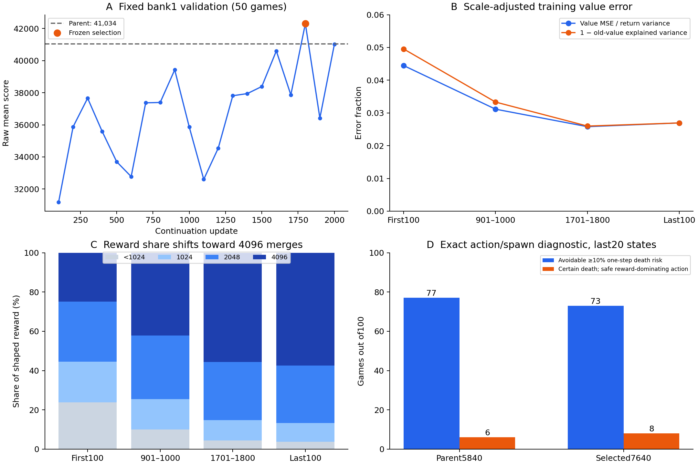

# What held the policy back?

This is a sanitized summary of completed diagnostic work, not a proposal to run
more experiments. Both frozen models' 100 bank16 episodes were reconstructed on
CPU and matched the original scores, lengths, and maximum tiles exactly.

1. **Local action mistakes are real.** On the fixed last 20 states of each game,
   the parent/selected policies had 77/73 games with an action carrying ≥10% immediate
   death probability despite a zero-death alternative. A stricter 6/8 games chose
   certain death despite a safe action with no smaller immediate shaped reward.
   Every spawn outcome was enumerated; the strict cases were independently checked
   with a cell-by-cell movement implementation. Full-game improvement from changing
   the action was not tested.
2. **No 8192 merge was observed in the added 131,072,000 transitions.** There were
   18,864 merges that produced a 4096 tile. Every bank16 final board had total tile mass below 8192.
   Longer survival and creation of a large partner tile are prerequisites; it is
   not simply a matter of merging two existing 4096 tiles at the terminal board.
3. **Raw value loss is not proof of critic collapse.** First/last 100-update value
   MSE rose 0.385→3.042 while return standard deviation rose 2.96→10.67. MSE divided
   by return variance fell 0.0445→0.0270 and old-value explained variance rose
   0.950→0.973. These are bootstrapped targets, so they do not prove long-horizon
   calibration. Risk-state realized returns suggest a calibration question, but
   greedy-vs-sampled-policy differences and conditioning on death prevent a simple
   causal diagnosis.
4. **Late learning was nearly frozen by design.** The last 100 mean LR was 8.1e−8,
   KL 4.19e−7, and ratio clip fraction 0. This does not identify whether more effective
   optimization, a different objective, exploration, or stronger planning would
   have helped. No capacity or training-schedule control was run.

Legal masks, terminal handling, GAE boundaries, reward reconstruction and update
counts were reviewed. No implementation failure was found in those paths. Layout
features such as corner occupancy and monotonicity were treated as descriptions,
not causes or proof of an optimal heuristic.

These observations support specific behavioral bottlenecks, but do not separate
optimization insufficiency from learned planning/representation limits. The
experiment ended here; there is no claimed 8192 solution or additional training.
